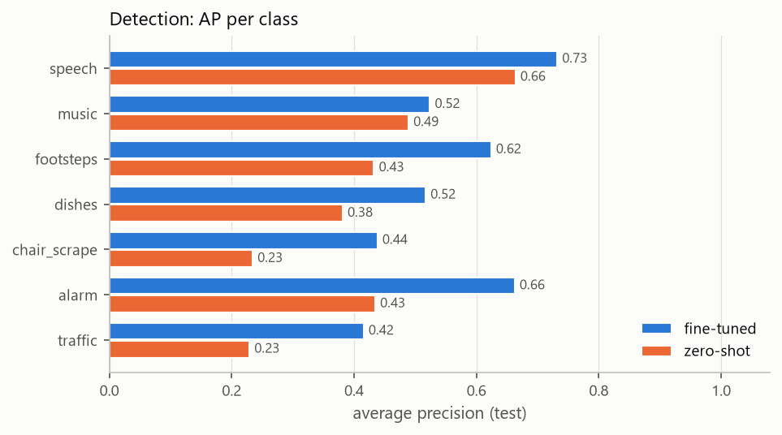
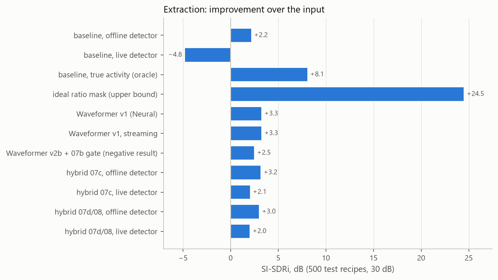
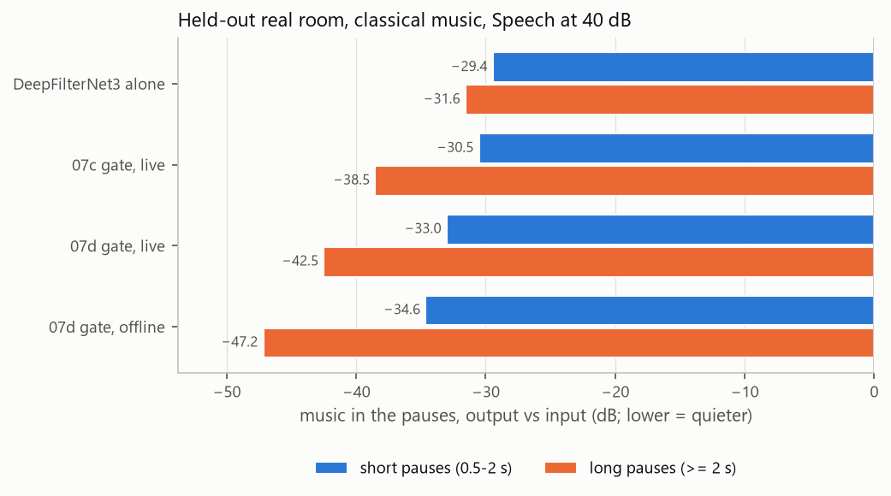
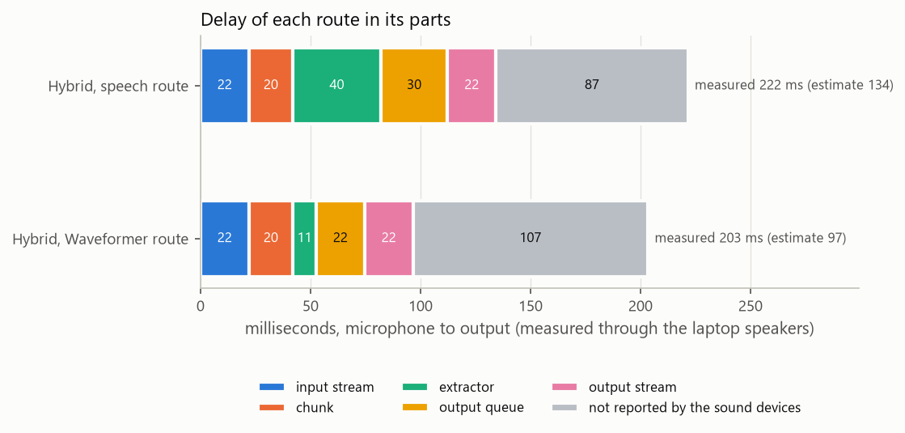

# Sound Spy: evaluation

*Generated by `soundspy report` on 2026-11-21 15:30 from the stored result files; nothing here is typed in by hand. Regenerate after new results; `soundspy report --rerun` re-runs the long evaluations first.*

Sound Spy listens through the laptop microphone and lets the user choose what to hear: the chosen sound types are kept, everything else is turned down (Tab 1, *Semantic*). This document collects the measurements behind it.

## 1. Setup

### Hardware

|  |  |
|---|---|
| CPU | 12th Gen Intel(R) Core(TM) i5-12450H |
| Logical cores | 12 |
| RAM | 16 GB |
| Graphics card | NVIDIA GeForce RTX 3050 Ti Laptop GPU, 4 GB |
| Microphone | laptop's built-in array (WASAPI, 48 kHz), Windows audio enhancements off |

### Software

| package | version |
|---|---|
| Python | 3.11.9 |
| OS | Windows 11 (build 26200) |
| numpy | 2.4.6 |
| torch | 2.11.0+cu126 |
| onnxruntime | 1.32.0 |
| sounddevice | 0.5.6 |
| fastapi | 0.162.7 |
| soundfile | 0.14.0 |
| soundspy | 0.1.0 |

### Datasets and models

| dataset | what | licence |
|---|---|---|
| ESC-50 | environmental sound clips | CC BY-NC 3.0 |
| FSD50K | Freesound clips with AudioSet labels | per clip: CC0, CC BY, CC BY-NC |
| LibriSpeech (test-clean, dev-clean) | read English speech | CC BY 4.0 |
| AudioSet ontology | class hierarchy | CC BY-SA 4.0 |

| model | role | licence |
|---|---|---|
| EfficientAT mn10_as | detector, fine-tuned | MIT |
| Waveformer | target sound extraction, fine-tuned (v1) | MIT |
| DeepFilterNet3 | speech enhancer, published weights | MIT / Apache-2.0 |

### Sound classes

| ID | shown as | description |
|---|---|---|
| `speech` | Speech | People talking: conversations, voices, announcements |
| `music` | Music | Songs and instrumental music, live or from speakers |
| `footsteps` | Footsteps | People walking: steps on hard floors |
| `dishes` | Dishes & cutlery | Plates, cups, pots and cutlery clinking |
| `chair_scrape` | Chair scraping | Chairs and furniture dragged or squeaking on the floor |
| `alarm` | Alarms | Alarms, beeps and ringing signals |
| `traffic` | Traffic | Road traffic and passing vehicles |

### Splits

Mixtures of 6 s rendered from recipes: 20000 / 2000 / 2000 (train / validation / test); the FSD50K development set split by uploader so that no recording person appears in two splits; ESC-50 by fold. The extraction tables use a fixed 500-recipe subset of the test split (seeded), the same for every system.

## 2. Detection

EfficientAT mn10_as (AudioSet-pretrained) zero-shot against the model fine-tuned on Sound Spy's mixtures (1 s windows; AP per class, F1 at the per-class threshold chosen on validation).

| class | val AP zero-shot | val AP fine-tuned | val F1 | test AP zero-shot | test AP fine-tuned | test F1 |
|---|---|---|---|---|---|---|
| `speech` | 0.659 | 0.759 | 0.695 | 0.664 | 0.732 | 0.658 |
| `music` | 0.501 | 0.549 | 0.571 | 0.489 | 0.524 | 0.567 |
| `footsteps` | 0.410 | 0.600 | 0.593 | 0.432 | 0.624 | 0.577 |
| `dishes` | 0.228 | 0.412 | 0.439 | 0.381 | 0.517 | 0.488 |
| `chair_scrape` | 0.198 | 0.429 | 0.451 | 0.234 | 0.438 | 0.434 |
| `alarm` | 0.382 | 0.595 | 0.568 | 0.434 | 0.662 | 0.583 |
| `traffic` | 0.356 | 0.493 | 0.510 | 0.229 | 0.415 | 0.431 |
| **mean** | 0.391 | **0.548** | 0.547 | 0.409 | **0.559** | 0.534 |

*Reproduce:* `soundspy evaluate detection --split test`

## 3. Extraction on synthetic test mixtures

500 test recipes (483 with the target present, 17 without), attenuation 30 dB, 48 kHz. SI-SDRi = improvement of the scale-invariant signal-to-distortion ratio over the input; *target absent* = output level against the input where the selected sound is not in the mixture (more negative = quieter); *worse* = recipes made more than 5 dB worse than the input.

| system | SI-SDRi mean | SI-SDRi median | target absent (dB) | worse by > 5 dB |
|---|---|---|---|---|
| input (nothing done) | +0.00 | +0.00 | 0.0 | 0 |
| baseline, offline detector | +2.19 | +0.00 | −26.6 | 53 |
| baseline, live detector | −4.85 | −0.96 | −28.7 | 175 |
| baseline, true activity (oracle) | +8.09 | +7.25 | −30.0 | 5 |
| ideal ratio mask (upper bound) | +24.52 | +18.24 | −100.0 | 0 |
| Waveformer v1 (Neural) | +3.28 | +3.32 | −12.5 | 51 |
| Waveformer v1, streaming | +3.28 | +3.32 | −12.5 | – |
| Waveformer v2b + 07b gate (negative result) | +2.51 | +2.58 | −17.1 | 66 |
| hybrid 07c, offline detector | +3.20 | +3.34 | −23.1 | 57 |
| hybrid 07c, live detector | +2.06 | +2.59 | −21.4 | 65 |
| hybrid 07d/08, offline detector | +3.02 | +3.18 | −22.9 | 59 |
| hybrid 07d/08, live detector | +2.04 | +2.74 | −21.3 | 67 |

*Reproduce:* `soundspy evaluate extraction --method mask_baseline | --method neural_tse | --method hybrid [--name ext_hybrid_08]`

**By target class** (SI-SDRi, dB)

| target class | baseline offline | Waveformer v1 | hybrid (07d gate, per-route delay) offline | hybrid (07d gate, per-route delay) live |
|---|---|---|---|---|
| `speech` | +3.74 | +3.60 | +3.96 | +3.54 |
| `music` | +0.64 | +2.65 | +2.58 | +1.61 |
| `footsteps` | +1.07 | +4.41 | +4.47 | +3.88 |
| `dishes` | +3.46 | +3.84 | +3.71 | +2.26 |
| `chair_scrape` | −0.32 | +0.16 | −1.42 | −2.15 |
| `alarm` | +3.80 | +3.75 | +3.83 | +2.52 |
| `traffic` | −0.39 | +2.46 | +2.27 | +2.10 |

**By target duration** (SI-SDRi, dB)

| target duration | baseline offline | Waveformer v1 | hybrid (07d gate, per-route delay) offline | hybrid (07d gate, per-route delay) live |
|---|---|---|---|---|
| < 1 s | +5.44 | +5.07 | +4.95 | +3.03 |
| 1 .. 3 s | +1.06 | +2.37 | +1.93 | +1.48 |
| >= 3 s | −2.66 | +1.27 | +1.16 | +1.08 |

## 4. Benchmarks

Fixed benchmark sets of the test split (step 07b): 200 recipes with every class selected while absent; 100 each of music only, speech + music with Speech or Music selected; 100 with LibriSpeech speech as the target.

| benchmark | baseline offline | baseline live | Waveformer v1 | hybrid (07d gate, per-route delay) offline | hybrid (07d gate, per-route delay) live |
|---|---|---|---|---|---|
| every class selected while absent: target absent (dB) | −26.1 | −26.5 | −12.6 | −18.2 | −18.9 |
| music only, Speech selected (dB) | −29.6 | −29.2 | −15.3 | −42.8 | −42.8 |
| speech + music, Speech selected: SI-SDRi | +7.09 | −4.64 | +5.33 | +4.86 | +4.61 |
| speech + music, Music selected: SI-SDRi | +0.04 | −6.88 | +2.11 | +2.17 | +1.58 |
| LibriSpeech read speech + one other: SI-SDRi | +7.52 | −5.39 | +8.06 | +12.04 | +11.88 |

**The speech route's gate (step 07d)** on the Speech-selected sets (30 dB):

| speech route | Speech alone | speech + music | music only (dB) | LibriSpeech |
|---|---|---|---|---|
| DeepFilterNet3, no gate | +6.97 | +6.27 | −24.3 | +12.18 |
| 07c hybrid gate (offline) | +7.13 | +7.00 | −45.2 | +12.49 |
| 07c hybrid gate (live) | +4.70 | +4.03 | −46.1 | +10.65 |
| 07d speech-route gate (offline) | +5.55 | +4.86 | −42.8 | +12.04 |
| 07d speech-route gate (live) | +4.84 | +4.61 | −42.8 | +11.88 |

*Reproduce:* `soundspy evaluate speech-gate --check`

*Reproduce:* `soundspy evaluate extraction --method hybrid`

## 5. Real room

The laptop microphone in the owner's room: speech, music and room tone recorded separately and mixed digitally, so the correct output (the recorded speech) is known exactly. Speech selected. **Tuning** data chose the settings; the **held-out** session was scored once, with the final settings.

### Held-out session `20261119-164017-bb5e+20261119-164508-2d33`

Mixtures: SI-SDRi at the speech-to-music ratios -5 / +0 / +5 / +10 dB (30 dB); music only: suppression; speech only: share of speech frames cut (40 dB).

| system | mixtures | music only (dB) | speech cut |
|---|---|---|---|
| baseline live | −4.84 / −1.86 / −2.71 / −4.95 | −40.0 | 30.7 % |
| Waveformer v1 | +3.74 / +3.33 / +2.49 / +1.19 | −22.5 | 5.6 % |
| DeepFilterNet3 alone | +11.70 / +10.28 / +8.39 / +6.39 | −25.8 | 0.2 % |
| 07c gate, live | +10.83 / +9.81 / +8.07 / +6.16 | −46.4 | 0.5 % |
| 07d gate, live | +10.48 / +9.88 / +8.17 / +6.26 | −46.4 | 0.3 % |
| 07d gate, offline | +10.48 / +9.90 / +8.16 / +6.21 | −46.4 | 0.3 % |

**Music in the pauses** (40 dB, output against input, pooled over the pauses; 0.5-2 s *short*, >= 2 s *long*):

| system | classical short | classical long | song short | song long |
|---|---|---|---|---|
| DeepFilterNet3 alone | −29.4 | −31.6 | −14.9 | −14.7 |
| 07c gate, live | −30.5 | −38.5 | −15.0 | −14.8 |
| 07d gate, live | −33.0 | −42.5 | −15.1 | −14.8 |
| 07d gate, offline | −34.6 | −47.2 | −15.1 | −14.8 |

### Tuning session `20261119-105248-00c1`

Mixtures: SI-SDRi at the speech-to-music ratios -5 / +0 / +5 / +10 dB (30 dB); music only: suppression; speech only: share of speech frames cut (40 dB).

| system | mixtures | music only (dB) | speech cut |
|---|---|---|---|
| baseline live | −0.77 / −2.21 / −2.06 / −2.97 | −28.7 | 19.8 % |
| Waveformer v1 | +0.25 / +2.06 / +2.50 / +1.52 | −18.7 | 4.8 % |
| DeepFilterNet3 alone | +13.63 / +11.76 / +9.23 / +6.54 | −25.4 | 0.2 % |
| 07c gate, live | +12.84 / +11.36 / +9.11 / +6.49 | −45.4 | 0.5 % |
| 07d gate, live | +12.49 / +11.13 / +8.94 / +6.42 | −45.5 | 0.2 % |
| 07d gate, offline | +12.54 / +11.08 / +8.92 / +6.42 | −45.5 | 0.2 % |

**Music in the pauses** (40 dB, output against input, pooled over the pauses; 0.5-2 s *short*, >= 2 s *long*):

| system | classical short | classical long | song short | song long |
|---|---|---|---|---|
| DeepFilterNet3 alone | −33.4 | – | −32.5 | – |
| 07c gate, live | −35.0 | – | −33.4 | – |
| 07d gate, live | −37.2 | – | −33.9 | – |
| 07d gate, offline | −38.0 | – | −34.7 | – |

The song has vocals: its singer is a voice to the speech enhancer, so it stays in the pauses for every system (a limitation, section 9).

*Reproduce:* `soundspy evaluate extraction --method hybrid --benchmark real --session <id>[+<id>] --name ext_hybrid_07d --role held-out`

## 6. Real time

**Delay changes of step 08** (each run a few minutes of the live chain, Listen on but muted; *delay* = the session's own estimate):

| change (cumulative) | selection | underruns | RTF p95 (worst) | delay (ms) | extractor (ms) |
|---|---|---|---|---|---|
| A 07c baseline | speech | 0 | 0.34 | 134 | 40.0 |
| A 07c baseline | music | 1 | 0.68 | 134 | 40.0 |
| B per-route delay | music | 1 | 0.72 | 115 | 10.6 |
| C + prebuffer 1 | speech | 2 | 0.40 | 124 | 40.0 |
| C + prebuffer 1 | music | 2 | 0.66 | 85 | 10.6 |
| D + chunk 10 ms | speech | 5 | 0.40 | 114 | 40.0 |
| D + chunk 10 ms | music | 1 | 0.92 | 75 | 10.6 |
| E + latency low | speech | 3 | 0.55 | 114 | 40.0 |
| F + exclusive 3 ms | speech | 34 | 0.41 | 156 | 40.0 |
| F + exclusive 3 ms | music | 43 | 1.00 | 126 | 10.6 |

*Reproduce:* `soundspy soak --minutes 3 --labels speech --set <key>=<value>`

**Measured delay** (acoustic loopback, 2026-11-21T15:27:44: laptop speakers to microphone; app rows = microphone to speaker through Sound Spy, the hardware round trip removed):

| path | median (ms) | min | max | clicks | estimate (ms) |
|---|---|---|---|---|---|
| hardware round trip | 149.8 | 149.8 | 149.8 | 10 | – |
| app, no processing | 193.2 | 192.1 | 193.2 | 10 | 94 |
| Hybrid, speech route | 221.6 | 221.0 | 221.8 | 10 | 124 |
| Hybrid, Waveformer route | 203.4 | 203.1 | 203.8 | 10 | 95 |

*Reproduce:* `soundspy measure-latency --all`

*The parts are the session's own figures, averaged over the latest soak of each route with the configured settings.*

**Long runs** (live microphone, Listen on but muted, the configured settings; *priority* = the audio thread's: `mmcss` = Windows' audio scheduler, added after the first two runs):

| started | route | min | priority | underruns | dropped (in / out) | RTF p95 (worst) | delay (ms) | RAM (MB) | VRAM (MB) |
|---|---|---|---|---|---|---|---|---|---|
| 2026-11-19 22:48 | waveformer | 10 | normal | 1 | 0 / 0 | 0.73 | 124.6 | 1264.6 -> 1222.1 | 58.0 -> 58.0 |
| 2026-11-19 23:19 | speech_enhancer | 30 | normal | 4 | 0 / 0 | 0.48 | 144.0 | 1264.6 -> 1262.4 | 58.0 -> 58.0 |
| 2026-11-20 00:05 | speech_enhancer | 30 | mmcss | 0 | 0 / 0 | 0.37 | 134.0 | 1253.6 -> 1189.2 | 58.0 -> 58.0 |
| 2026-11-20 00:15 | waveformer | 10 | mmcss | 0 | 0 / 0 | 0.61 | 94.6 | 1265.0 -> 1190.4 | 58.0 -> 58.0 |

*Reproduce:* `soundspy soak --minutes 30 --labels speech   # and --labels music`

**Soak** (30 min, hybrid speech_enhancer, 40 dB): 0 underruns, 0 / 0 chunks dropped (input / output), RTF p95 median 0.296 (worst 0.3724), RAM 1253.6 -> 1189.2 MB, graphics card 58.0 -> 58.0 MB.

Minute by minute (the latest 30-minute run):

| minute | underruns | RTF p95 | RAM (MB) | VRAM (MB) |
|---|---|---|---|---|
| 1 | 0 | 0.26 | 1254 | 58 |
| 2 | 0 | 0.26 | 1261 | 58 |
| 3 | 0 | 0.34 | 1262 | 58 |
| 4 | 0 | 0.28 | 1262 | 58 |
| 5 | 0 | 0.27 | 1186 | 58 |
| 6 | 0 | 0.29 | 1187 | 58 |
| 7 | 0 | 0.34 | 1188 | 58 |
| 8 | 0 | 0.20 | 1188 | 58 |
| 9 | 0 | 0.36 | 1187 | 58 |
| 10 | 0 | 0.37 | 1185 | 58 |
| 11 | 0 | 0.30 | 1187 | 58 |
| 12 | 0 | 0.23 | 1187 | 58 |
| 13 | 0 | 0.33 | 1189 | 58 |
| 14 | 0 | 0.35 | 1189 | 58 |
| 15 | 0 | 0.29 | 1189 | 58 |
| 16 | 0 | 0.27 | 1188 | 58 |
| 17 | 0 | 0.28 | 1187 | 58 |
| 18 | 0 | 0.30 | 1190 | 58 |
| 19 | 0 | 0.32 | 1188 | 58 |
| 20 | 0 | 0.34 | 1186 | 58 |
| 21 | 0 | 0.30 | 1189 | 58 |
| 22 | 0 | 0.29 | 1190 | 58 |
| 23 | 0 | 0.33 | 1188 | 58 |
| 24 | 0 | 0.24 | 1190 | 58 |
| 25 | 0 | 0.27 | 1189 | 58 |
| 26 | 0 | 0.27 | 1190 | 58 |
| 27 | 0 | 0.32 | 1188 | 58 |
| 28 | 0 | 0.29 | 1190 | 58 |
| 29 | 0 | 0.30 | 1189 | 58 |
| 30 | 0 | 0.33 | 1189 | 58 |

*Reproduce:* `soundspy soak --minutes 30`

**Start-up**: server up in 4.06 s, models ready 11.34 s after start (1277.3 MB RAM, 58.0 MB on the graphics card); first session: 0.91 s from Start to audio, 0 underruns.

## 7. Negative results

- **Waveformer v2 / v2b (step 07b)**: retrained with a loss that punishes leakage in silent 50 ms frames, dynamic mixing and LibriSpeech. Less leakage, lower quality: SI-SDRi +2.88 without and +2.51 dB with its output gate, against v1's +3.28 dB; most of the step's targets were missed and v1 stays the configured model (v2b kept on disk).
- **The output gate for the Waveformer (step 07b)**: a gate that listens only to the network's own output cannot see the network's confident mistakes (music it takes for the target leaks at −12 to −20 dB and holds the gate open) and it ducked quiet syllables. With v1: SI-SDRi +2.97 dB, target absent −14.0 dB; off by default. On the speech route the same idea works (step 07d) because the speech enhancer's output is 20 dB further from music than the Waveformer's.
- **Cascade (step 07c)**: Waveformer then DeepFilterNet3 for Speech was worse than DeepFilterNet3 alone on every speech benchmark except silence.
- **Detector hop 0.5 s (step 07c)**: halved the detector's CPU time, the RTF did not change; reverted.

## 8. Reproducing

Every table above names its command; the results live in `experiments/` (`metrics.json`, `real_room.json`, `experiments/realtime/`), listening examples in `outputs/eval/`.

## 9. Limitations

- **Several talkers**: the speech enhancer keeps every voice; telling one person from another is the job of the Spatial and Sources tabs (microphone array, modules 3 and 5).
- **Singing** counts as a voice: a song with vocals stays audible in the pauses (about −15 dB in the real room).
- **Very quiet input**: the laptop microphone peaks around −29 dBFS; the speech enhancer needed a +10 dB input gain not to remove the first seconds of speech (step 07c).
- **The laptop microphone** is one fixed device with Windows' processing switched off; other microphones need their own device profile and a new real-room session.
- **First start**: the server loads and warms its models in the background (section 6); a session started meanwhile waits in the *warming* state.
- **Delay**: measured through the laptop speakers, the speech route takes 222 ms from microphone to speaker, 98 ms more than the session's own estimate: the sound devices' round trip is 150 ms where PortAudio reports 44 ms (section 6). DeepFilterNet3's 40 ms are part of the model; headphones may have a different device delay.
- **Music the speech enhancer takes for a voice** reopens the speech route's gate (some classical passages, singing).
- **Synthetic mixtures** do not predict the real room well (step 07b); the real-room tables are the closer measure.

